

<picture><source media="(prefers-color-scheme: dark)" srcset="assets/hero-dark.svg"></picture>

<picture><source media="(prefers-color-scheme: dark)" srcset="assets/social-l-dark.svg"></picture><a href="https://t.me/foby_bio"><picture><source media="(prefers-color-scheme: dark)" srcset="assets/social-1-dark.svg"></picture></a><a href="https://discord.com/users/809802466555854878"><picture><source media="(prefers-color-scheme: dark)" srcset="assets/social-2-dark.svg"></picture></a><a href="https://tiktok.com/@fobycool"><picture><source media="(prefers-color-scheme: dark)" srcset="assets/social-3-dark.svg"></picture></a><picture><source media="(prefers-color-scheme: dark)" srcset="assets/social-r-dark.svg"></picture>

<a href="https://fobycool.xo.je/"><picture><source media="(prefers-color-scheme: dark)" srcset="assets/button-1-dark.svg"></picture></a>&nbsp;&nbsp;<a href="https://github.com/FobyCool?tab=repositories"><picture><source media="(prefers-color-scheme: dark)" srcset="assets/button-2-dark.svg"></picture></a>

<picture><source media="(prefers-color-scheme: dark)" srcset="assets/wave-dark.svg"></picture>

<picture><source media="(prefers-color-scheme: dark)" srcset="assets/about-dark.svg"></picture>

<picture><source media="(prefers-color-scheme: dark)" srcset="assets/stack-dark.svg"></picture>

<a href="https://github.com/FobyCool/Palaziks_kernel"><picture><source media="(prefers-color-scheme: dark)" srcset="assets/project-palaziks-kernel-dark.svg"></picture></a>&nbsp;<a href="https://github.com/FobyCool/LSPromise-Build"><picture><source media="(prefers-color-scheme: dark)" srcset="assets/project-lspromise-build-dark.svg"></picture></a>

<a href="https://github.com/FobyCool/Better-Il2CppDumper"><picture><source media="(prefers-color-scheme: dark)" srcset="assets/project-better-il2cppdumper-dark.svg"></picture></a>&nbsp;<a href="https://github.com/FobyCool/BioWebsite"><picture><source media="(prefers-color-scheme: dark)" srcset="assets/project-biowebsite-dark.svg"></picture></a>

<picture><source media="(prefers-color-scheme: dark)" srcset="assets/stats-dark.svg"></picture>

<picture><source media="(prefers-color-scheme: dark)" srcset="assets/streak-dark.svg"></picture>

<a href="https://metawka.github.io/expressive-profile/?from=FobyCool"><picture><source media="(prefers-color-scheme: dark)" srcset="assets/credit-dark.svg"></picture></a>

